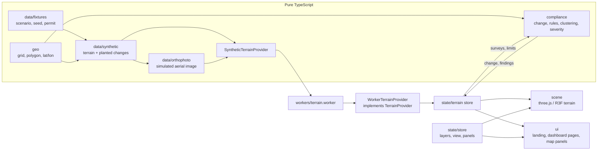

# PitWatch 3D

**Live demo: [pitwatch-3d.vercel.app](https://pitwatch-3d.vercel.app)** (landing page), or [open the dashboard](https://pitwatch-3d.vercel.app/#/overview)

A browser dashboard that helps a mining inspector check an open-pit mine against its permit from two terrain surveys. It shows the mine as a 3D model, measures what changed between a baseline and a current survey, and runs transparent rules that flag digging outside the lease, digging below the approved floor and dumping outside permitted zones.

PitWatch supports risk-based inspection planning. It does not replace a site visit and does not prove a legal breach.

> **Simulated data.** Venthar Ridge Iron Pit, Ardent Ore Works and every survey here are fictional. The terrain, the aerial images and the planted changes are generated from a fixed seed. The app shows a permanent SIMULATED DATA badge and tags every value with where it came from.

## What it does today

- **Landing page** (`#/`): the live 3D model (drag to turn it), with four buttons (Baseline, Current, Change, Findings) that switch what it shows: the baseline survey, the current survey, the measured change coloured on the terrain (rust cut, blue fill) and the findings with the lease line and a pin for each. No scrolling story; a short section on the three permit rules follows.
- **Dashboard** with a sidebar (a slim icon rail on the 3D map, a drawer on phones):
  - **Overview** (`#/overview`): the verdict, four headline figures, the result for each permit rule, the findings to look at first, and the survey, surface and lease facts. An interactive site plan draws the lease, permitted zones, changed cells and finding pins from the same data as the 3D map; select a pin with a pointer, touch, Enter or Space to open its finding on the map.
  - **Findings** (`#/findings`): every finding as a ruled row with its figures, filters by status and rule, the explanation on demand, Show on map, **Copy link**, **Download CSV** (every row marked simulated), **Download PDF** (a plan of the lease with each finding, every page marked simulated) and a clean **Print report** view.
  - **Permit rules** (`#/rules`), **Uncertainty** (`#/uncertainty`: combined survey σ, the noise band and the threshold the rules report beyond, plus the resolution comparison) and **About the data** (`#/about`, with the keyboard shortcuts).
- **3D map** (`#/monitor`):
  - 3D terrain of the current survey with a simulated aerial image draped over it. The block sides show a soil profile.
  - Optional elevation tint, with colours spread so the plateau's relief shows, and optional 5 m contours.
  - Vertical exaggeration from 1× to 3×.
  - Oblique, top and pit camera views, a compass and a live scale bar.
  - Click the terrain with the Inspect tool to read a point (elevation ± uncertainty, change, slope, lease and pit-floor status, findings there), or switch to Measure for distances, grade and an elevation profile of current against baseline. Without a mouse, type an easting and northing in the Inspector tab instead.
  - A survey slider on the timeline switches the map between the baseline and current surveys. Findings can be opened from their pins and flown to from the Findings tab.
  - Overlay layers: lease boundary, safety buffer, pit and dump zone outlines, measured change (excavated and filled, only beyond the reporting threshold of 0.5 m plus twice the combined survey σ) and finding markers, all drawn from the engine output.
  - Header compliance status, and a details panel with a Findings tab (every finding with its explanation and figures) and an Inspector tab.
  - A link such as `#/monitor?finding=R2-1` opens the map on that finding, and the address follows whichever finding is selected, so what is on screen can be shared.
  - Selecting a finding restores the current survey, terrain and finding markers, frames the chosen pin and opens the Findings tab. Selection stays synchronized with the Overview. On phones, the details drawer closes to reveal the terrain and retains the selected finding when reopened.
  - On phones the details drawer opens on the findings, with the layer switches and vertical exaggeration under a Map layers disclosure below them. On larger screens, the Map card holds these controls; its key can be folded to leave more room.
- **Compliance engine** (`src/compliance/`): change detection, rules R1–R3, clustering into findings, severity and plain-English explanations. All of it is pure TypeScript and unit-tested.

The original M1–M8 milestones are complete, and so is every item on the [competition improvement plan](docs/competition-ui-ux-improvement-plan.md): it is kept as the record of how that work was planned, not as a list of open work. The palette lint guard (#32) shipped on 2026-10-29. Five follow-up tickets remain open in this repo, each `ready-for-agent`: #33 the report's real symbols, #34 its page splitting (blocked by #33), #35 the map card at 800 px, #36 a first-visit tour, #37 horizontal survey error on a point reading. The parent it tracks has none.

## Try the inspection workflow

1. Open the landing page and switch between **Baseline**, **Current**, **Change** and **Findings** to see how the two simulated surveys lead to the engine results.
2. Open **Overview** to read the permit-rule results and locate the five findings on the site plan.
3. Select a site-plan pin or choose **Show on map** on a finding. The map restores the evidence layers and frames the selected result.
4. Open **Inspector** to read a terrain point, or enter its easting and northing. Switch to **Measure** and choose two points to compare distance, grade and the survey profiles.
5. Visit **Permit rules**, **Uncertainty** and **About the data** to inspect the thresholds, uncertainty assumptions and source limitations behind the result.

## Data honesty

- Every displayed value carries a provenance tag: `measured`, `derived`, `simulated` or `unverified`.
- Elevations are shown as value ± vertical uncertainty (σ).
- No alert is hand-written. Every finding comes from the rule engine running on the two surveys.
- The About the data page explains what different sources can show:
  - satellite imagery shows the surface, not depth;
  - global DEMs (Copernicus GLO-30, SRTM, about 30 m cells, metres of vertical error) are too coarse for bench-scale change;
  - drone, LiDAR or DGPS surveys are what mine-scale monitoring needs.

## The rules

Let σ be the uncertainty of the difference between the surveys, σ = √(σ1² + σ2²), and k = 2.

| Rule        | Checks                                     | Violation                             | Warning                                             |
| ----------- | ------------------------------------------ | ------------------------------------- | --------------------------------------------------- |
| Change      | Δh = current − baseline per cell           |                                       |                                                     |
| R1 Boundary | excavated cells (Δh < −(minChange + kσ))   | centre outside the lease              | inside the lease, within the safety buffer          |
| R2 Depth    | current ground inside an approved pit zone | more than kσ below the approved floor | below the floor but within kσ (cannot be confirmed) |
| R3 Dumping  | filled cells (Δh > +(minChange + kσ))      |                                       | outside every designated dump zone                  |

Flagged cells are grouped into findings with 8-connected components. Each finding has an area, a volume (Σ|Δh| × cell area; for R2, volume below the floor), the largest exceedance, a centroid and a severity. Severity comes from thresholds on area, volume and exceedance:

- a violation is critical or high;
- a warning is medium or low.

Each finding also gets an explanation such as:

> Excavated 7,696 m² outside the lease boundary; deepest cut 52.5 m ± 0.14 m (2σ). About 175,300 m³ removed.

Every threshold (k, `minChangeM`, severity limits) lives in [`src/compliance/config.ts`](src/compliance/config.ts).

The seeded scenario produces exactly these findings, locked by a snapshot test:

| Id   | Finding                                                   | Status              |
| ---- | --------------------------------------------------------- | ------------------- |
| R1-1 | Pushback of the east wall past the lease edge             | violation, critical |
| R2-1 | Sump dug about 4 m below the approved floor               | violation, high     |
| R1-2 | The same pushback where it crosses the 20 m safety buffer | warning             |
| R3-1 | Truck-tipped heaps outside the dump zone                  | warning             |
| R1-3 | Shallow scrape inside the safety buffer                   | warning, low        |

## Run it

Requires npm and Node.js matching `^20.19.0 || >=22.12.0`, as declared in `package.json`. CI uses Node 22.

```sh
npm ci
npm run dev          # http://localhost:5173
```

| Command                           | What it does                                   |
| --------------------------------- | ---------------------------------------------- |
| `npm run dev`                     | Dev server with hot reload                     |
| `npm run typecheck`               | TypeScript, strict                             |
| `npm run lint`                    | ESLint                                         |
| `npm test`                        | Vitest, once (`npm run test:watch` to watch)   |
| `npm run test:e2e`                | Playwright checks against the production build |
| `npm run verify`                  | Typecheck, lint, format check and unit tests   |
| `npm run build`                   | Typecheck and production build into `dist/`    |
| `npm run preview`                 | Serve the production build                     |
| `npm run format` / `format:check` | Prettier                                       |

The terrain (two 513 × 513 surveys at 4 m spacing plus their aerial images) is generated in Web Workers when the page opens: one worker per survey, running in parallel, so the wait is the slower survey rather than the sum. Generation time depends on the device. If loading fails, **Try again** retries in place.

The browser checks run against the production build, so run `npx playwright install chromium` once before the first `npm run test:e2e`. CI (GitHub Actions) runs `npm run verify`, the build and the Playwright suite on every push to `main` and every pull request, and uploads the report when a run fails.

Run the full local checks with:

```sh
npm run verify && npm run test:e2e
```

For the responsive browser review, start `npx vite --port 5179 --strictPort` and review the landing page, Overview and 3D map at 1440, 1100 and 800 px wide. Include a phone-width check for the navigation and details drawers.

## Deploy

The app is a static site on Vercel. The GitHub repo is connected to the `pitwatch-3d` project, so every push to `main` builds and publishes [pitwatch-3d.vercel.app](https://pitwatch-3d.vercel.app). Build settings live in [`vercel.json`](vercel.json) (`npm run build`, output `dist/`). Routing uses the URL hash (`#/overview`, `#/monitor` and so on), so no rewrites are needed.

To deploy by hand from a logged-in machine:

```sh
npx vercel deploy --prod
```

## Architecture



- `src/domain`, `src/data`, `src/geo` and `src/compliance` are pure TypeScript. ESLint blocks React, three.js and Zustand imports there, so the geometry and rules are testable on their own. The same lint pass rejects a hardcoded colour anywhere in `src` other than the palette, so the colour rule is enforced rather than remembered.
- `TerrainProvider` (`getMine`, `listSurveys`, `getSurvey`, `getLimits`) is the seam for real data. A GeoTIFF DEM or surveyed-surface provider can replace the synthetic one without touching rendering or rules.
- Coordinates are a local metric grid (X east, Y north, RL in metres). The fictional origin lat/lon is for display only; a real system would use a projected CRS such as UTM.

```text
src/
  domain/       types: Mine, TerrainSurvey, PermittedLimits, ComplianceFinding, TerrainProvider
  data/         seeded RNG and noise, scenario fixtures, synthetic terrain, aerial image, providers
  geo/          grid maths, point-in-polygon, distances, area and volume, lat/lon display
  compliance/   change detection, R1–R3, connected components, severity, explanations
  scene/        R3F terrain, shaders (aerial/tint blend, contours, soil profile), camera rig
  state/        Zustand stores: app UI state, loaded terrain and findings
  ui/           landing page, dashboard shell and pages, site plan, panels, map HUD
  workers/      terrain generation off the main thread
```

## Stack

Vite, React 19, TypeScript (strict), three.js with @react-three/fiber and drei, Tailwind CSS v4, Zustand, Vitest, ESLint and Prettier. There is no backend: everything runs in the browser.

## Roadmap

|     | Milestone                                                                   | Status |
| --- | --------------------------------------------------------------------------- | ------ |
| M1  | App shell, tooling                                                          | done   |
| M2  | Domain types, geo utilities, synthetic terrain                              | done   |
| M3  | 3D terrain view                                                             | done   |
| M4  | Compliance engine and scenario snapshot                                     | done   |
| M5  | Overlays: lease boundary, buffer, change map, finding markers               | done   |
| M6  | Panels: point picking, measure tool and profile chart, epoch slider, fly-to | done   |
| M7  | Polish: accessibility, performance, share metadata                          | done   |
| M8  | Deployment config (Vercel) and final checks                                 | done   |

## Limits and follow-up work

- This is a frontend demonstration using a fictional permit and synthetic surveys. There is no backend, real survey ingestion or regulatory certification.
- Vertical survey uncertainty is modelled; horizontal position error is not (ticket #37). A coordinate outside the survey grid can still be inspected for position and lease status, but has no elevation or change reading.
- Below 1280 px the details panel starts closed so the model keeps the room; the header's Details button or `]` brings it back, and `[` toggles the Map card. At 800 px the Map card still covers part of the model (ticket #35).
- There is no first-visit tour (ticket #36). The map explains itself with contextual hints (click or tap to read a point, then A and B to measure), the icon rail labels each icon on hover and keyboard focus, and the landing model carries a "Drag to turn" label.

See the [competition improvement plan](docs/competition-ui-ux-improvement-plan.md) for how the interface work was planned (all of it delivered), [STATUS.md](STATUS.md) for the current handoff, and [AGENTS.md](AGENTS.md) for the detailed update log and contributor workflow.
