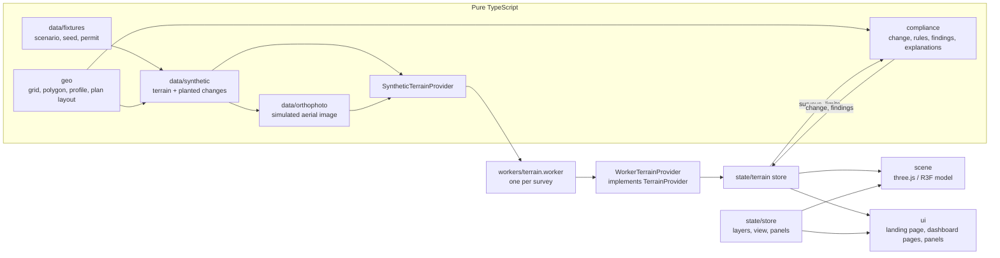

# PitWatch 3D

**Live site: [pitwatch-3d.vercel.app](https://pitwatch-3d.vercel.app)**, or go straight to the [dashboard](https://pitwatch-3d.vercel.app/#/overview).

PitWatch is a web app for checking an open-pit mine against its permit. It compares two terrain surveys of the same mine, taken months apart, and shows what changed on a 3D model. A small set of rules then flags ground dug outside the lease, dug below the approved pit floor, or dumped outside the permitted zones. Each flag comes with the numbers behind it, so an inspector can decide where to look first.

It is a planning aid. It does not replace a site visit and it does not prove a legal breach.

> **Simulated data.** The mine (Venthar Ridge Iron Pit), its operator (Ardent Ore Works), the permit and both surveys are fictional. The terrain, the aerial images and the changes are generated from a fixed seed, so everyone sees the same mine. The app says so on every page.

## What you can do

**Landing page (`#/`).** A live 3D model of the simulated mine. A before/after slider moves it from the Baseline survey to the Current one; in between, the model is a blend of the two, and the caption says it is an illustration, not a survey. Two switches add layers on the current survey: **Show change** colours rock removed in rust and rock added in blue, and **Show permit findings** draws the lease line on the ground and rings each finding with a tag showing its id and severity shape. A scale bar and north arrow keep it readable.

To move the model, drag to turn and tilt it, and pinch or use the mouse wheel to zoom (click the model first so the page does not scroll). Double click or **Reset view** puts it back. Phones also get two turn buttons. With the model focused, the arrow keys turn it, `+` and `-` zoom, and `0` resets.

Below the model, a worked example follows one finding, R1-1, from the two survey heights to the verdict, with every figure taken from the engine. A short ledger then lists what the engine tests and what it found for each rule.

**Dashboard.** A sidebar leads to six pages:

- **Overview** (`#/overview`): one sentence that answers "is anything wrong, and where?", a site plan of the lease with every finding marked, the three most serious findings and three headline figures.
- **3D map** (`#/monitor`): the full model. Switch layers on and off (lease, safety buffer, zones, change, findings, contours, elevation tint), exaggerate the height up to 3×, and jump between Oblique, Top and Pit views. Click a point to read its height, change and lease status, or measure the distance, grade and profile between two points. You can also type a coordinate instead of clicking.
- **Findings** (`#/findings`): every finding with its figures and the evidence behind it, filters by status and rule, and **Show on map**, **Copy link**, **Download CSV**, **Download PDF** and **Print report**.
- **Permit rules** (`#/rules`): the three rules in plain words, with the live result for each.
- **Uncertainty** (`#/uncertainty`): try the noise test yourself with sliders, and see how survey resolution changes what can be detected.
- **About the data** (`#/about`): where each kind of value comes from, what real data sources can and cannot show, and the keyboard shortcuts.

A link such as `#/monitor?finding=R2-1` opens the map on that finding, so a view can be shared.

## Run it locally

You need Node.js `^20.19.0 || >=22.12.0` (CI uses Node 22) and npm.

```sh
npm ci
npm run dev          # opens on http://localhost:5173
```

The two surveys are built in your browser when the page opens, in two background workers, so the first load takes a few seconds. If it fails, **Try again** retries without a reload.

| Command            | What it does                                            |
| ------------------ | ------------------------------------------------------- |
| `npm run dev`      | Development server with hot reload                      |
| `npm run verify`   | Typecheck, lint, format check and unit tests            |
| `npm test`         | Unit tests once (`npm run test:watch` to keep watching) |
| `npm run test:e2e` | Browser tests (Playwright) against a production build   |
| `npm run build`    | Typecheck and build the site into `dist/`               |
| `npm run preview`  | Serve the built site                                    |
| `npm run format`   | Format every file with Prettier                         |

Before the first `npm run test:e2e`, install the browser once with `npx playwright install chromium`. The full local check is:

```sh
npm run verify && npm run test:e2e
```

GitHub Actions runs `verify`, the build and the browser tests on every pull request and every push to `main`.

## How it works

The app has three parts, and data flows one way through them.

1. **Data.** A seeded generator builds the mine: a baseline survey and a current survey, each a grid of 513 × 513 heights at 4 m spacing (about 2 km square), plus a simulated aerial photo for each. The changes an inspector should find are planted in the current survey. The surrounding ground outside the 2 km block is decoration only; nothing is measured on it.
2. **Engine.** For every cell, the engine subtracts the baseline height from the current one, decides whether the change is bigger than the surveys' own error, groups flagged cells into findings and writes a plain-English explanation for each.
3. **Interface.** The pages and the 3D model draw what the engine reports. No alert is written by hand.

### Honesty rules

- Every value carries a tag that says where it came from: `measured`, `derived`, `simulated` or `unverified`.
- Heights and changes are shown with their ± uncertainty. σ (sigma) is a survey's own measurement error; here it is 0.05 m in height and 0.10 m in position, both simulated.
- The dashboard shows a SIMULATED DATA label, and the landing page a "simulated data" note.
- Every exported row (CSV) and page (PDF) is marked simulated.

### When does a change count?

Two surveys never agree exactly, even over untouched ground. So the engine combines the error of both surveys, σ = √(σ1² + σ2²), and uses k = 2 (about 95% confidence). A change is reported only if it is larger than **0.5 m + 2σ**. With the default 0.05 m surveys that is 0.64 m. The 0.5 m allowance keeps tyre ruts and grading out of the findings.

### The three rules

| Rule        | What it looks at                      | Violation                             | Warning                                                  |
| ----------- | ------------------------------------- | ------------------------------------- | -------------------------------------------------------- |
| R1 Boundary | ground lowered beyond the threshold   | outside the lease                     | inside the lease but within the 20 m safety buffer       |
| R2 Depth    | current ground inside an approved pit | more than 2σ below the approved floor | below the floor but within 2σ, so it cannot be confirmed |
| R3 Dumping  | ground raised beyond the threshold    |                                       | outside every permitted dump zone                        |

R2 compares the current ground with a fixed approved floor, so it uses the current survey's σ alone and has no 0.5 m allowance.

Flagged cells that touch (including diagonally) form one finding. Each finding has an area, a volume, its largest exceedance, a centre and a severity: a violation is critical or high, a warning medium or low, depending on area, volume and exceedance limits. A typical explanation reads:

> Excavated 7,696 m² outside the lease boundary; deepest cut 52.5 m ± 0.14 m (2σ). 175,297 m³ removed.

Every threshold lives in [`src/compliance/config.ts`](src/compliance/config.ts).

### What the simulated mine produces

The seed always gives these five findings, and a snapshot test fails if any of them changes:

| Id   | Finding                                                   | Status              |
| ---- | --------------------------------------------------------- | ------------------- |
| R1-1 | The east wall pushed back past the lease edge             | violation, critical |
| R2-1 | A sump dug about 4 m below the approved floor             | violation, high     |
| R1-2 | The same pushback where it crosses the 20 m safety buffer | warning, medium     |
| R3-1 | Truck-tipped heaps outside the dump zone                  | warning, medium     |
| R1-3 | A shallow scrape inside the safety buffer                 | warning, low        |

## Reference

### Architecture



- `src/domain`, `src/data`, `src/geo` and `src/compliance` are plain TypeScript with no React, three.js or Zustand. ESLint enforces this, so the rules and geometry can be tested on their own. Lint also rejects a hard-coded colour anywhere outside the palette.
- `TerrainProvider` (`getMine`, `listSurveys`, `getSurvey`, `getLimits`) is where real data would plug in. A provider that reads real survey files could replace the synthetic one without touching the rules or the drawing.
- Coordinates are local metres (X east, Y north, height as RL). The latitude and longitude shown are for display only; a real system would use a projected grid such as UTM.

### Folders

```text
src/
  domain/       shared types: Mine, TerrainSurvey, PermittedLimits, ComplianceFinding, TerrainProvider
  data/         seeded noise, the scenario, synthetic terrain, aerial images, surrounding ground, providers
  geo/          grid maths, polygons, distances, profiles, area and volume, site-plan layout
  compliance/   change detection, rules R1–R3, findings, severity, explanations, reports
  scene/        the 3D model, shaders, overlays and camera
  state/        Zustand stores: interface state, loaded surveys and findings
  ui/           landing page, dashboard shell and pages, panels, map controls, PDF export
  workers/      survey generation off the main thread
e2e/            Playwright browser tests
```

### Stack

Vite, React 19, TypeScript (strict), three.js with @react-three/fiber and drei, Tailwind CSS v4, Zustand, jsPDF, Vitest, Playwright, ESLint and Prettier. There is no backend: everything runs in the browser.

### Deploy

The site is static and hosted on Vercel. The repository is connected to the `pitwatch-3d` project, so every push to `main` publishes [pitwatch-3d.vercel.app](https://pitwatch-3d.vercel.app). Build settings are in [`vercel.json`](vercel.json) (`npm run build`, output `dist/`). Pages use the part of the address after `#`, so the host needs no rewrite rules. To deploy by hand from a logged-in machine, run `npx vercel deploy --prod`.

### Known limits

- Everything is simulated. There is no real survey import, no backend and no regulatory certification.
- The engine judges whole 4 m cells by their centre. Near the lease line, the Inspector says when the 0.10 m position error means the side cannot be confirmed, but the engine does not use that band.
- Frame rate has only been measured with software rendering, not on a real graphics card.
- No licence has been chosen yet, so the License page says all rights are reserved. The Terms page is a draft without legal review.
- The PDF report covers Latin and Greek letters; a name in another script prints `?`.

## More

- [STATUS.md](STATUS.md): the current state of the project.
- [AGENTS.md](AGENTS.md): working rules, design notes and the full update log.
- [docs/](docs): plans, bug checks and the tracker conventions in [docs/agents](docs/agents).
